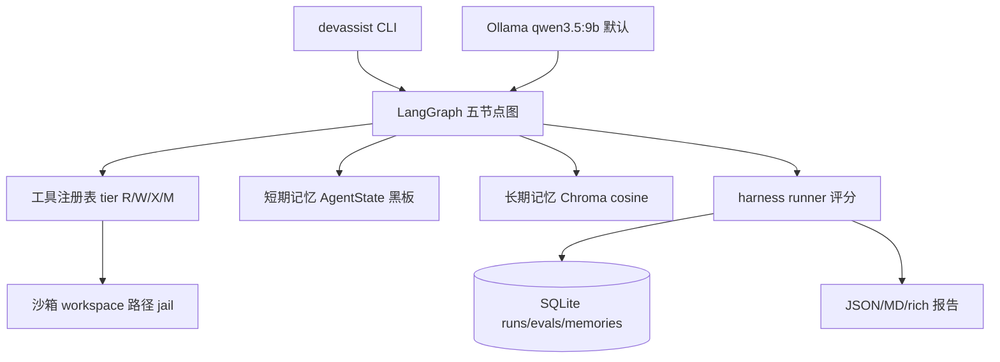

# multiagent_dev_assistant

仓库级智能研发助手：**多 Agent 协同 + 双层记忆 + 工具体系 + 评测 harness**，交互形态为 **CLI**（`devassist`）。

输入任务描述（缺陷/特性），LangGraph 五节点图（**planner → explorer → coder ⇄ tester → reviewer**，有界循环）在沙箱 workspace 中**真实执行测试**，产出带测试通过证据的代码 diff 与量化指标报告。

> 设计基准：[`docs/architecture.md`](docs/architecture.md) · 执行顺序：[`docs/plan.md`](docs/plan.md) · 指标汇总：[`eval_report.md`](eval_report.md)



## 环境要求

- Windows 11 + Git Bash（或兼容 shell）
- Python **3.12**（仅用 [uv](https://docs.astral.sh/uv/) 管理）
- [Ollama](https://ollama.com)：`qwen3.5:9b`、`qwen3-embedding:4b`
- 可选：OpenAI / Anthropic API Key（缺 key **显式失败**，不静默降级）

```bash
git clone <repo>
cd multiagent_dev_assistant
uv sync
uv run python --version    # 3.12.x
ollama pull qwen3.5:9b
ollama pull qwen3-embedding:4b
cp .env.example .env       # 按需修改
```

默认 `OLLAMA_NUM_CTX=65536`（本机 64k 稳定；OOM 时下调）。

## 快速上手

```bash
# 单任务：终端真流式事件（node/tool/llm_delta/test_result）
uv run devassist run --task T001 --suite smoke --provider ollama

# 批量评测 + 报告（JSON + MD + rich 表）
uv run devassist eval --suite smoke --k 1 --provider ollama

# 记忆 A/B（on/off 双跑 + 自动 compare）
uv run devassist eval --suite main --k 1 --provider ollama --ab

# 仓库约定抽取 → 长期记忆
uv run devassist memory onboarding --path sample_repo

# 预览注入（--memory on 时会拼进 prompt 的片段）
uv run devassist memory preview "错误处理约定"
```

## CLI 手册

| 命令 | 说明 |
|---|---|
| `devassist run --task T001 --suite smoke [--memory on\|off]` | 单任务，终端实时事件流 |
| `devassist eval --suite smoke\|main --k N [--ab] [--adapter local\|swe_bench]` | 批量评测 / 记忆 A/B / Benchmark |
| `devassist report --eval <id>` | 查看单份报告 |
| `devassist compare a.json b.json` | A/B 对比 delta 表 |
| `devassist tasks list\|show --suite smoke` | 套件浏览 |
| `devassist runs list [--task] [--status]` | 历史 run |
| `devassist runs show <id> [--events] [--diff]` | 回放 / 补丁 |
| `devassist memory onboarding --path <repo>` | 约定抽取 |
| `devassist memory list [--kind convention\|episode]` | 记忆列表 |
| `devassist memory search "…" [--kind]` | 向量检索 |
| `devassist memory show <id>` | 单条全文 |
| `devassist memory preview "…"` | 注入预览 |

**退出码**：`0` 全部成功 · `1` 存在失败任务 / 资源不存在 · `2` 配置或环境错误。

## 架构要点

| 层 | 实现 |
|---|---|
| 编排 | LangGraph StateGraph，五节点 + 条件边，`MAX_ITERATIONS=8` 有界循环 |
| 短期记忆 | `AgentState` 黑板（plan/exploration/diff/test_history/review） |
| 长期记忆 | SQLite `memories` + Chroma `long_term_memory`（cosine、`repo_id` 过滤） |
| 工具 | tier **R/W/X/M** 授权硬校验；路径 jail；无任意 shell |
| 沙箱 | 每 run 独立 workspace 副本；隐藏测试评分阶段才注入 |
| 评测 | pass@k、tool_calls 分 tier、max_hit、wall_s；JSON/MD/rich |
| LLM | 双通道：Ollama 默认 / OpenAI 兼容 / Anthropic；`think:false` 防思维链耗尽 |

## 任务套件

| 套件 | 条数 | 用途 |
|---|---|---|
| `suites/smoke` | 3 | Gate / 冒烟 |
| `suites/main` | 12 | 正式集（bugfix/feature/refactor，难度分层） |
| `suites/swe_bench` | ≤10 子集 | SWE-bench Lite **字段格式**适配 |

**SWE-bench 口径声明**：子集字段兼容官方 `instance_id/problem_statement`，但测试在**本地 workspace 沙箱**执行，**不等于**官方 Docker 分数，不冒充官方成绩。

## 开发

```bash
uv run ruff check .          # 0 error
uv run pytest -q             # 全绿
uv run devassist --help
```

CI：GitHub Actions 跑 `ruff` + `pytest`（不在 CI 跑全量 harness——需本地模型）。

## 文档

| 文档 | 内容 |
|---|---|
| [`docs/architecture.md`](docs/architecture.md) | 架构、决策、数据模型、事件协议 |
| [`docs/plan.md`](docs/plan.md) | 里程碑 M1–M4、feature 清单、Gate |
| [`eval_report.md`](eval_report.md) | M1–M4 关键评测数字汇总 |
| [`CLAUDE.md`](CLAUDE.md) | 执行指引与质量红线 |
| `docs/screenshots/` | 终端演示截图 |

## License

MIT
