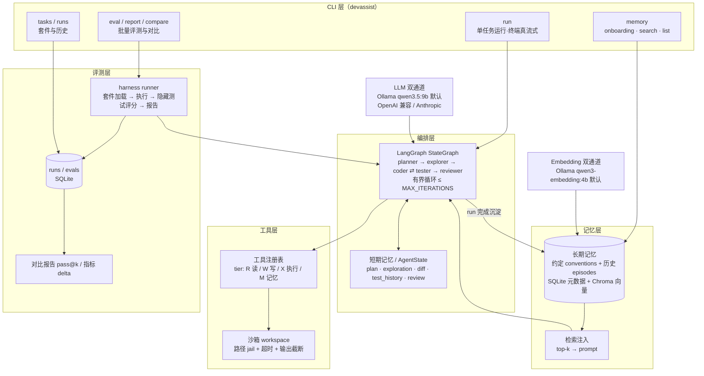

# multiagent_dev_assistant 架构设计

> 本文是项目的**设计基准**：做什么、做成长什么样以本文为准；执行顺序与提交节奏见 `docs/plan.md`。
> 文档自包含，不依赖任何外部仓库或历史项目。

---

## 0. 已确认决策（需求方拍板，不得擅自更改）

| # | 决策点 | 结论 |
|---|--------|------|
| D1 | 业务场景 | **A：仓库级智能研发助手**——输入任务描述（缺陷/特性），多 Agent 协同产出「带测试通过证据的代码 diff」 |
| D2 | 仓库形态 | **全新独立仓库** `multiagent_dev_assistant`，与既有 RAG 作品互不依赖 |
| D3 | 模型通道 | **双通道**：本地 Ollama（默认，5060Ti 16GB）+ API 强模型（OpenAI 兼容 / Anthropic）；缺 key 显式失败，禁止静默降级 |
| D4 | 评测任务集 | **两条腿**：前期自建 sample_repo + 自制任务套件；后期接入公开 benchmark 子集（走统一 Adapter 接口） |
| D5 | 交互形态 | **CLI 优先**（typer + rich）；**静态页面挂路由后续再定**——M1–M4 不做 Web。核心层（图/记忆/工具/harness）与展示层解耦，未来加 FastAPI/静态页不改核心 |

**本地默认模型**：`qwen3.5:9b`（Q4 约 6.6GB，`coding`/`tools`/`thinking` 能力标签，256K 原生上下文；16GB 显存下权重 + KV cache 留有充足余量。拉取 `ollama pull qwen3.5:9b`）。
Embedding 默认：`qwen3-embedding:4b`（本机已有，长期记忆检索用）。

---

## 1. 系统总览

仓库级智能研发助手：任务套件 → **多 Agent 图**（Planner → Explorer → Coder → Tester → Reviewer，有界循环）→ 真实执行测试 → diff + 指标报告；**短期记忆** = 图内任务状态（黑板），**长期记忆** = 仓库约定 + 历史任务沉淀（检索注入）；**评测 harness** 对任务集批量跑 Agent，产出可对比的量化报告。**人机界面是 CLI**：单任务运行、批量评测、记忆管理、报告对比全部命令行完成。



**展示层解耦约定**：runner 只产出**事件流**（落 `run_events`）+ 终态结果；CLI 订阅事件打印。未来若加 Web，仅新增 FastAPI/SSE 读同一份 `run_events`，核心零改动。

---

## 2. 技术定稿（已确认，不得擅自更改）

| 维度 | 决策 |
|---|---|
| 执行环境 | Windows 11 + Git Bash；Python 固定 **3.12**；环境管理**只用 uv**；禁用 `python3`/裸 `python`/conda |
| 编排 | **LangGraph** `StateGraph` + 条件边 + 有界循环 + **SqliteSaver checkpointer**（`thread_id = run.id`） |
| 交互 | **CLI 优先**：`typer` 子命令 + `rich` 终端输出；**M1–M4 无 Web/HTTP 服务** |
| LLM 通道 | `LLM_PROVIDER = ollama \| openai \| anthropic`；默认 **ollama + `qwen3.5:9b`** |
| Embedding 通道 | `EMBED_PROVIDER = ollama \| openai`（**无 anthropic**）；默认 `qwen3-embedding:4b` |
| 关系库 | **SQLite**（单文件，零外部服务；本项目单用户本地工具） |
| 向量库 | Chroma 内嵌，单一 collection `long_term_memory`，**显式 cosine**；按 `repo_id` 过滤 |
| 沙箱 | 进程级：workspace 每 run 独立副本 + 路径 jail + 超时 + 输出截断；**M1–M4 不引入 Docker 沙箱** |
| 运行时 | 单进程异步 runner；事件**先落库**再交 CLI 打印（DB 为事实源） |
| 前端 | **M1–M4 不做**（D5）；未来静态页 hash 路由为可选扩展，不进本计划 |
| 真实性 | 测试**必须真实执行**；隐藏测试只在评分阶段注入，**Agent 全程不可见** |
| 测试 | pytest（图节点/条件边/工具 jail/授权/harness 评分/事件顺序；LLM 一律 mock） |
| CI | GitHub Actions：`ruff check` + `pytest`（**不**在 CI 跑全量 harness——需本地模型） |
| 交付 | GitHub 公开仓库 + 终端演示截图 ≥4 张 + `eval_report.md` |

### 明确不做（防蔓延）

M1–M4 内的 Web/HTTP/SSE/静态页（后续再定）、多语言代码库（仅 Python）、IDE 插件、自动向远端开 PR、多用户/登录/权限、WebSocket、K8s/分布式、Docker 强依赖、前端构建/npm/图表库、rerank/BM25 混合检索、浏览器操作（computer use）、真实 CI 平台深度集成。

---

## 3. 目录结构

```
multiagent_dev_assistant/
├── CLAUDE.md
├── docs/
│   ├── plan.md
│   ├── architecture.md          # 本文
│   └── screenshots/             # 终端演示截图
├── README.md
├── LICENSE
├── .gitignore
├── .python-version              # 3.12
├── uv.lock
├── .env.example
├── pyproject.toml               # console script: devassist
├── .github/workflows/ci.yml
├── eval_report.md
├── app/
│   ├── config.py                # pydantic-settings，读 .env
│   ├── cli/
│   │   ├── main.py              # typer 入口，挂载子命令
│   │   ├── run_cmd.py           # 单任务运行 + 终端事件订阅（真流式）
│   │   ├── eval_cmd.py          # 批量评测 / report / compare
│   │   ├── tasks_cmd.py         # 套件与任务列表
│   │   ├── runs_cmd.py          # 历史列表、--events 回放、diff 查看
│   │   └── memory_cmd.py        # onboarding / search / list
│   ├── agents/
│   │   ├── graph.py             # LangGraph 装配、条件边、循环上限
│   │   ├── state.py             # AgentState（短期记忆 schema）
│   │   ├── nodes/               # planner / explorer / coder / tester / reviewer
│   │   └── prompts/             # 各节点系统提示（含记忆注入模板）
│   ├── memory/
│   │   ├── long_term.py         # 存/取/检索（SQLite + Chroma）
│   │   ├── onboarding.py        # 仓库约定抽取（LLM）
│   │   └── episodes.py          # run 完成后历史沉淀
│   ├── tools/
│   │   ├── registry.py          # 注册表、schema、tier、超时、输出上限
│   │   ├── fs_tools.py          # read_file / grep / list_dir
│   │   ├── write_tools.py       # write_file / edit_file（workspace 约束）
│   │   ├── exec_tools.py        # run_tests / run_lint（沙箱执行）
│   │   └── memory_tools.py      # memory_search / memory_save
│   ├── llm/
│   │   ├── client.py            # 三通道统一接口（含流式、usage 计数）
│   │   └── embed.py             # 双通道 embedding
│   ├── harness/
│   │   ├── schema.py            # TaskDefinition / RunMetrics / Report
│   │   ├── loader.py            # 套件 YAML 加载与校验
│   │   ├── runner.py            # 单任务执行 + 评分 + 落库（产出事件流）
│   │   ├── report.py            # JSON / MD / 终端表，pass@k、对比
│   │   └── adapters/
│   │       ├── base.py          # BenchmarkAdapter 接口
│   │       ├── local.py         # 自建套件（M1）
│   │       └── swe_bench.py     # 公开 benchmark 子集（M4，≤10 条）
│   ├── events.py                # 事件类型定义 + run_events 落库
│   ├── db/                      # SQLAlchemy 模型 + session
│   └── sandbox/
│       └── workspace.py         # run 副本创建、路径 jail、清理
├── suites/
│   ├── smoke/                   # 3 条，M1 Gate 用
│   │   ├── tasks/*.yaml
│   │   └── hidden_tests/
│   └── main/                    # 10–15 条，M3 扩充
│       ├── tasks/*.yaml
│       └── hidden_tests/
├── sample_repo/                 # 自建演示仓库（约 20 文件，自带 pytest）
├── data/                        # .gitignore：sqlite、chroma、workspaces、runs、reports
└── tests/                       # 项目自身单测（LLM mock）
```

---

## 4. 多 Agent 编排（LangGraph）

### 4.1 节点与工具授权

| 节点 | 职责 | 工具 tier | 输入 | 写入 state |
|---|---|---|---|---|
| `planner` | 任务理解 → 分步计划 | R | task、记忆注入 | `plan` |
| `explorer` | 按计划定位代码，产出文件摘要 | R | `plan` | `exploration`（file → summary） |
| `coder` | 按计划+探索结果生成/修改代码 | **R + W** | plan、exploration、review 反馈、test_history | `diff`、`scratch` |
| `tester` | 真实执行 pytest / ruff | **R + X** | 当前 workspace | `test_history` 追加一条 |
| `reviewer` | 对照任务验收 + 仓库约定审查 | R | 全部 state、约定注入 | `review`（approve / reject + 理由） |

授权是**硬约束**（registry 层校验），不是提示词约定：explorer 拿不到写工具，coder 拿不到执行工具之外的任意 shell。

### 4.2 图与循环

```
planner → explorer → coder → tester ──fail──→ coder   （迭代 ≤ MAX_ITERATIONS=8）
                          ↑                  │
                          │                pass
                          │                  ↓
                          └──reject──── reviewer ──approve→ END
```

- `tester` fail → 回 `coder`（携带失败输出）
- `tester` pass → `reviewer`
- `reviewer` reject → 回 `coder`（携带 review 理由）；若连续 reject 2 次且根因是计划错误 → 回 `planner`（仅一次）
- 循环触顶 → 以 `status=timeout` 结束，仍产出当前 diff 与报告（**失败也是数据**）
- 条件边与循环上限全部有单测

### 4.3 短期记忆 = AgentState（任务级黑板）

```python
class AgentState(TypedDict):
    task: TaskDefinition            # 任务描述（只读）
    plan: list[PlanStep]            # planner 产出
    exploration: dict[str, str]     # 相对路径 → 摘要
    scratch: str                    # coder 的思考草稿
    diff: str                       # 当前 unified diff
    test_history: list[TestRecord]  # 每轮: {iteration, passed, failed, output_tail}
    review: ReviewRecord | None
    iteration: int
    memory_context: str             # 注入的约定 + 相似历史（M3）
    messages: list[AnyMessage]      # LangGraph 消息通道
```

- 持久化：SqliteSaver checkpointer，`thread_id = run.id`——**崩溃可恢复、可回放**
- 每次节点/工具/测试动作产生**事件**写入 `run_events`（CLI 实时打印 + 事后 `runs show --events` 回放）
- 突出原则：**状态是唯一事实源**，节点不互相直接传参，全部读写黑板

### 4.4 长期记忆（跨任务）

两类记忆，统一 `memories` 表 + Chroma 向量：

| kind | 内容 | 写入时机 | 读取方式 |
|---|---|---|---|
| `convention` | 仓库约定：分层规范、命名、错误处理、测试风格、禁用模式 | 仓库 onboarding（LLM 抽取，人可改） | 按 `task` 相似度 top-k 注入 planner/coder/reviewer |
| `episode` | 历史任务：任务摘要 → 解法思路 → diff 摘要 → 结果 → 教训 | run 终态后自动沉淀（LLM 压缩） | 按任务相似度 top-k 注入 planner |

- 注入格式：`## 仓库约定（长期记忆）\n...`、`## 相似历史任务\n...`，**可开关**（`--memory off`），供 A/B 评测
- 检索：embedding cosine top-k（默认 k=5，分数阈值 0.35，低于阈值不注入）
- onboarding：`devassist memory onboarding --path <repo>` 扫描仓库树 + README + 关键文件 → LLM 产出约定初稿 → 落库；M1 可先对 sample_repo 手工写入约定，自动抽取放 M3

---

## 5. 工具调用体系

### 5.1 注册表

每个工具注册：`name / description / JSON Schema / tier / timeout_s / output_limit_chars`。

| Tier | 工具 | 授予节点 |
|---|---|---|
| **R 读** | `read_file`、`grep`、`list_dir` | 全部节点 |
| **W 写** | `write_file`、`edit_file` | coder |
| **X 执行** | `run_tests`（pytest 子集）、`run_lint`（ruff） | tester |
| **M 记忆** | `memory_search`、`memory_save` | planner / reviewer |

- **无任意 shell**：执行类只有白名单命令，参数受限
- LLM 通过标准 tool-calling 循环调用；registry 校验 tier，越权 → 工具错误回灌（不抛崩图）

### 5.2 沙箱（sandbox/workspace.py）

- 每 run：`data/workspaces/{run_id}/` = `sample_repo`（或目标仓库）完整副本
- **路径 jail**：一切读写解析后必须落在 workspace 内（含 `..`、绝对路径、符号链接逃逸），违例拒绝——**必须有专门单测**
- 执行：`subprocess`，`cwd=workspace`，超时（默认 120s），stdout/stderr 截断（默认 20k 字符）保留头尾
- 隐藏测试：**评分阶段**才把 `suites/*/hidden_tests/` 注入 workspace 并执行；Agent 运行期间 workspace 内不存在这些文件
- run 结束保留 workspace 供查看，清理策略：手动 + 启动时清理超过 7 天的目录

---

## 6. 评测 Harness

### 6.1 任务定义（YAML）

```yaml
id: T001
title: 订单核销幂等保护
repo: sample_repo
difficulty: medium          # easy | medium | hard
prompt: |
  <自然语言任务描述，Agent 只看到这个>
hidden_tests:
  - tests/test_idempotency.py
max_iterations: 8
timeout_s: 300
tags: [bugfix, api]
```

### 6.2 执行流程（runner）

1. 加载任务 → 创建 workspace 副本（**不含**隐藏测试）
2. 组装 AgentState + 记忆注入（按开关）→ 跑图至终态
3. 注入隐藏测试 → 真实执行 pytest → 评分
4. 记录指标 → 落库（`runs` + `run_events`）→ 沉淀 episode（M3）
5. 汇总为报告条目

### 6.3 指标

| 指标 | 定义 |
|---|---|
| `resolve` | 全部隐藏测试通过（布尔） |
| `test_pass_ratio` | 通过数 / 隐藏测试总数 |
| `pass@k` | 标准无偏估计；`k=1` 即 resolve rate |
| `iterations` / `max_hit` | 实际循环轮数 / 是否触顶 |
| `tool_calls` | 按 tier 分组计数 |
| `tokens_in` / `tokens_out` | 来自 provider usage 累加（本地模型用估算口径，报告注明） |
| `wall_s` | 端到端耗时 |
| `status` | `success` / `timeout` / `error` |

### 6.4 报告与对比

- 每次评测产出 `data/reports/{eval_id}.json`（机器）+ Markdown 表（人读）+ 终端 rich 表 + `eval_report.md` 汇总
- `devassist compare a.json b.json` → 逐任务 delta 表（如：记忆 on vs off、本地 vs API、prompt v1 vs v2）
- **面试弹药**：A/B 报告直接回答「你怎么知道它变好了」

### 6.5 Benchmark Adapter（D4 后期接入）

```python
class BenchmarkAdapter(Protocol):
    def load_tasks(self) -> list[TaskDefinition]: ...
```

- `local.py`（M1）：读 `suites/`，自建任务
- `swe_bench.py`（M4）：读 SWE-bench Lite 官方 task JSON 字段（`instance_id / problem_statement / patch` 参考），**取 ≤10 条 Python 实例**；测试执行仍走本地沙箱——README 必须注明与官方 Docker 执行口径的差异（不冒充官方分数）

### 6.6 CLI（console script `devassist`）

```bash
# 单任务（终端订阅事件，真流式）
uv run devassist run --task T001 --suite smoke --provider ollama --memory on

# 批量评测与报告
uv run devassist eval    --suite smoke --k 1 --provider ollama --memory on
uv run devassist eval    --suite main  --k 3 --provider anthropic --memory off
uv run devassist report  --eval <id>
uv run devassist compare <a.json> <b.json>

# 套件 / 历史
uv run devassist tasks list --suite smoke
uv run devassist runs list
uv run devassist runs show <id> --events      # 事件时间线回放
uv run devassist runs show <id> --diff        # 查看产出 diff

# 记忆
uv run devassist memory onboarding --path sample_repo
uv run devassist memory list --kind convention
uv run devassist memory search "错误处理约定" --k 5
```

---

## 7. 数据模型（SQLite）

| 表 | 关键字段 |
|---|---|
| `runs` | id, task_id, suite, status, provider, model, memory_on, iteration, metrics_json, diff_path, error, created_at, finished_at |
| `run_events` | id, run_id, seq（单调递增）, type, payload_json, ts |
| `evals` | id, suite, k, provider, model, memory_on, status, report_path, created_at |
| `eval_items` | eval_id, task_id, run_id, resolve, pass_ratio, iterations, tokens_in, tokens_out, wall_s, status |
| `memories` | id, repo_id, kind(`convention`\|`episode`), title, content, task_ref?, created_at, updated_at |
| `repos` | id, name, path, onboarding_status, created_at |

- 向量不在 SQLite：`memories.id` ↔ Chroma `id`，collection `long_term_memory`，metadata `{repo_id, kind}`
- LangGraph checkpoint 独立存 SqliteSaver（同库不同表）

---

## 8. 事件协议与 CLI 展示

### 8.1 事件类型（`app/events.py`，顺序固定，`seq` 单调）

```
run_started → (node_enter → llm_delta×N → tool_call → tool_result → node_exit)*
            → test_result×N → memory_injected? → run_finished | error
```

- `llm_delta`：节点内 LLM 流式 token——**CLI 逐 token 打印**（真流式，禁止整段切片）
- 事件**先落库**（`run_events`）再交展示层；DB 为事实源
- 终态后 `devassist runs show <id> --events` 全量回放（读 `run_events`）

### 8.2 CLI 展示约定

- `run`：实时打印节点进入/退出、工具调用与结果摘要、测试输出尾部、LLM delta；结束打印 diff 指纹与 metrics 摘要
- `eval`：任务级进度行 + 结束 rich 表（resolve / pass_ratio / iterations / wall_s）
- 退出码：`0` 全部成功，`1` 存在失败任务，`2` 配置/环境错误——便于脚本化与 CI 复用

### 8.3 未来扩展（不进 M1–M4）

FastAPI + SSE + 静态 hash 路由页：只读 `run_events` 与 REST 包装，核心零改动（见 §1 解耦约定）。

---

## 9. 配置表（.env）

| 变量 | 默认 | 说明 |
|---|---|---|
| `LLM_PROVIDER` | `ollama` | `ollama \| openai \| anthropic` |
| `OLLAMA_HOST` | `http://127.0.0.1:11434` | |
| `LOCAL_MODEL` | `qwen3.5:9b` | 本地默认，**不得降级** |
| `OLLAMA_NUM_CTX` | `16384` | 16GB 显存上限保护；OOM 时下调 |
| `OPENAI_API_KEY` / `OPENAI_BASE_URL` / `OPENAI_MODEL` | 空 | 缺 key 显式失败 |
| `ANTHROPIC_API_KEY` / `ANTHROPIC_MODEL` | 空 | 同上 |
| `EMBED_PROVIDER` | `ollama` | `ollama \| openai` |
| `EMBED_MODEL` | `qwen3-embedding:4b` | |
| `DATABASE_URL` | `sqlite:///./data/app.db` | |
| `CHROMA_DIR` | `./data/chroma` | cosine |
| `WORKSPACE_ROOT` | `./data/workspaces` | |
| `MAX_ITERATIONS` | `8` | 图循环上限 |
| `TOOL_TIMEOUT_S` | `120` | 单次执行超时 |
| `MEMORY_TOP_K` / `MEMORY_MIN_SCORE` | `5` / `0.35` | 检索注入阈值 |

---

## 10. 质量红线（细节见 CLAUDE.md）

1. 工具**路径 jail** 必须单测覆盖（`..`、绝对路径、符号链接）
2. 隐藏测试 Agent **不可见**；测试**真实执行**，禁止 mock 评分结果
3. 双通道缺 key **显式失败**；本地默认模型不得降级
4. 事件顺序固定、`seq` 单调、先落库再展示；`llm_delta` CLI 真流式
5. 授权硬校验：节点越权调用工具必须被 registry 拒绝（有负向测试）
6. 核心与展示解耦：runner 不依赖 CLI/Web；M1–M4 不引入 HTTP 路由
7. 每 commit：`uv run ruff check .` 0 error + 相关 `uv run pytest` 通过
8. 记忆可开关，A/B 报告可复现
